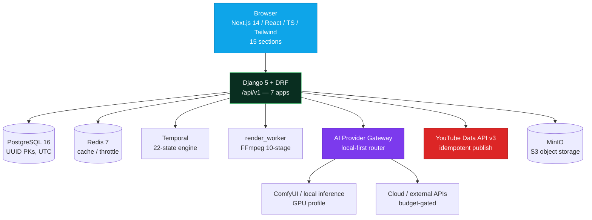

<div align="center">
  
</div>

<div align="center">

[](https://github.com/softwareproscompany-debug/TubeForgeAI/actions/workflows/ci.yml)


**Describe a content goal; TubeForge orchestrates the entire production lifecycle.**

</div>

<div align="center">
  
</div>

## Architecture



## Core guarantees

- **Local-first generation** — the provider gateway routes to self-hosted models
  whenever they meet quality/compatibility/latency requirements. Paid providers
  are never engaged silently; paid fallback requires explicit approval.
- **No per-generation-credit model** — local GPU, cloud GPU, CPU/RAM, storage,
  API spend, and YouTube quota are tracked as *separate* resources. The UI never
  merges them into a single "credits" metric.
- **Durable workflows** — Temporal orchestrates the 22-state production state
  machine; work survives process and machine restarts and resumes from
  scene-level checkpoints.
- **Idempotent publishing** — idempotency keys on publication create; resumable
  uploads reconcile before retry; duplicate requests never create duplicate
  projects, generation tasks, or publication records.
- **Traceable assets** — every asset carries source, model, settings, seed, and
  license metadata; every render ships a manifest (asset hashes, timeline
  version, renderer version, encoding settings, validation results).
- **Budget enforcement is server-side** — global → channel → project → workflow
  hierarchy, evaluated before any paid submit.

## Deployment notes

Only Caddy publishes host ports. Postgres/Redis/Temporal/MinIO are never
exposed publicly. GPU services start only with `docker compose --profile gpu up`;
without them the app runs fully — generation jobs queue as
`BLOCKED_ON_RESOURCES` instead of failing.

Backend apps: `core` (auth, users, secrets, audit), `channels` (records, OAuth,
automation rules), `research` (runs, sources, ideas), `projects` (scripts, scenes,
assets, timelines, renders), `providers` (registry, local-first router, budgets,
ledger), `workflows` (22-state engine, Temporal), `publishing` (YouTube client,
upload state machine, analytics).

## Repository layout

| Path | Contents | Files |
|---|---|---|
| `backend/` | Django 5 + DRF, 7 apps, migrations, 26 unit tests | 79 |
| `frontend/` | Next.js 14 + TS + Tailwind, 15 sections + editor | 37 |
| `infra/` | docker-compose, Caddyfile, .env.example, prometheus.yml | 4 |
| `.github/workflows/ci.yml` | 11-stage CI/CD pipeline | 1 |
| `tests/` | integration (provider contract, recovery) + scripted e2e | 5 |

## Quickstart

Prerequisites: Docker + Compose plugin, and (for the frontend typecheck) Node 20.

```bash
# 1. Configure — every variable is documented in the example file.
cp infra/.env.example infra/.env
# Edit infra/.env: set SECRET_KEY, FERNET_KEY, POSTGRES_PASSWORD,
# S3 keys, and (for publishing) YOUTUBE_CLIENT_ID/SECRET/REDIRECT_URI.
# Generate safe values, e.g.:
#   python3 -c "import secrets; print(secrets.token_urlsafe(64))"
#   python3 -c "from cryptography.fernet import Fernet; print(Fernet.generate_key().decode())"

# 2. Start the application stack (works with NO GPU services).
cd infra
docker compose up -d --build

# 3. (Optional) Start GPU workers — ComfyUI + local inference.
docker compose --profile gpu up -d --build

# 4. Run migrations & create the owner account.
docker compose exec api python manage.py migrate
docker compose exec api python manage.py createsuperuser

# 5. Open the app:  https://<PUBLIC_APP_URL>   (Caddy terminates TLS)
#    API health:    https://<PUBLIC_APP_URL>/api/v1/health
```

**Local development without Docker:**

```bash
# Backend
cd backend
python -m venv .venv && source .venv/bin/activate
pip install -r requirements.txt
export TESTING=true SECRET_KEY=dev-only FERNET_KEY=$(python -c "from cryptography.fernet import Fernet; print(Fernet.generate_key().decode())")
python manage.py migrate   # sqlite in TESTING mode
python manage.py runserver

# Frontend
cd frontend
npm install
echo "NEXT_PUBLIC_API_URL=http://localhost:8000" > .env.local
npm run dev
```

## Environment

All configuration lives in `infra/.env.example` (85 documented variables). The
backend **fails startup** (`ImproperlyConfigured`) when `SECRET_KEY`,
`FERNET_KEY`, or `DATABASE_URL` are missing/unsafe — there are no usable
defaults for secrets. Key variables:

`SECRET_KEY` · `DEBUG` · `ALLOWED_HOSTS` · `DATABASE_URL` (or `POSTGRES_*`) ·
`REDIS_URL` · `TEMPORAL_HOST`/`TEMPORAL_NAMESPACE`/`TEMPORAL_TASK_QUEUE` ·
`S3_ENDPOINT`/`S3_ACCESS_KEY`/`S3_SECRET_KEY`/`S3_BUCKET` · `FERNET_KEY` ·
`YOUTUBE_CLIENT_ID`/`YOUTUBE_CLIENT_SECRET`/`YOUTUBE_REDIRECT_URI` ·
`PUBLIC_APP_URL` · `NEXT_PUBLIC_API_URL` · `AI_WORKER_CONCURRENCY` ·
`MAX_RENDER_CONCURRENCY` · `COMFYUI_URL` · `DEFAULT_ROUTING_POLICY`

## API

Versioned at `/api/v1` (see `backend/config/urls.py`). Highlights:

- `POST /api/v1/auth/login` → `{token, user}` (`Authorization: Token <token>`)
- `POST /api/v1/channels/connect` → `{authorization_url, state}` (Google OAuth,
  signed timestamped state; refresh tokens Fernet-encrypted at rest)
- `POST /api/v1/projects/{id}/generate-plan` → structured plan, **never executes**
- `POST /api/v1/projects/{id}/workflows` → starts the durable Temporal workflow
  (synchronous fallback runner when Temporal is unreachable, recorded in
  `output_summary`)
- `POST /api/v1/publications` (**requires `idempotency_key`** — duplicates
  return the existing job with HTTP 200)
- `GET /api/v1/workflows/{id}/events/stream` — Server-Sent Events
- Errors always: `{"error":{"code","message","retryable","correlation_id"}}`

Workflow states: `DRAFT → PLANNING → AWAITING_APPROVAL → QUEUED → RESEARCHING →
SCRIPTING → STORYBOARDING → GENERATING_ASSETS → GENERATING_NARRATION →
ASSEMBLING → RENDERING → VALIDATING → FINAL_REVIEW → READY_TO_PUBLISH →
UPLOADING → SCHEDULED → PUBLISHED`, plus `FAILED / CANCELED / PAUSED /
BLOCKED_ON_RESOURCES / BLOCKED_ON_APPROVAL`. Only legal transitions are
accepted (`workflows/engine.py`); canceled runs ignore late worker callbacks.

## Roadmap (spec §17)

- **Phase 1 — Foundation** ✅ scaffolded: auth, channels, projects, migrations,
  navigation, settings, audit logging, dev deployment.
- **Phase 2 — Durable automation** ✅ scaffolded: Temporal workflows, state
  machine, queue, events, retry/cancel semantics. *Exit gate still open:*
  failure-injection proof against a live Temporal server.
- **Phase 3 — AI generation engine** ✅ scaffolded: registry, local-first
  router, ComfyUI adapter, usage accounting. *Open:* point it at real model
  endpoints and run the self-hosted test workflow.
- **Phase 4 — Media production** ✅ scaffolded: scenes, versioned timelines,
  FFmpeg 10-stage worker, incremental rendering, manifests. *Open:* real
  ffmpeg runs + preview assets.
- **Phase 5 — YouTube publishing** ✅ scaffolded: OAuth, resumable uploads
  with reconcile, scheduling, analytics ingestion. *Open:* connect real
  credentials and run the controlled test-channel publish.
- **Phase 6 — Intelligence & automation** ✅ scaffolded: research runs,
  automation rules, approvals. *Open:* provider-backed research sources.
- **Phase 7 — Production hardening** ⏳ partial: security tests, throttling,
  audit, CI security scans. *Open:* backup/restore drills, rollback drill,
  release checklist sign-off.

## DEFERRED — explicitly not implemented (with reasons)

These are spec items the scaffold does not genuinely deliver. Nothing else was
silently dropped.

1. **Live YouTube upload end-to-end** — all protocol code is real (OAuth
   exchange, resumable upload with 308-reconcile, tokeninfo, revoke), but
   exercising it requires real `YOUTUBE_CLIENT_ID/SECRET` and user consent.
   Environmental, not a stub.
2. **Temporal durable execution against a live server** — workflow definition,
   9 activities, scene-level checkpointing, and signals are real; without a
   reachable Temporal server the API falls back to the synchronous stage
   runner and records `execution_mode` in `output_summary`.
3. **Actual FFmpeg rendering** — command builder, 10-stage worker, ffprobe
   validation, and render manifests are real; execution needs the ffmpeg
   binary (installed in `backend/Dockerfile`).
4. **Realtime via WebSockets** — spec allows WS *or* SSE; SSE is implemented
   (`/workflows/{id}/events/stream`). A WS upgrade is deferred.
5. **pgvector** — listed in the spec stack, but no vector-search feature is
   scaffolded yet; ordinary Postgres is used.
6. **Prometheus client instrumentation** — `infra/prometheus.yml` scrapes the
   stack and alert rules are sketched (commented block), but the API does not
   yet expose a `/metrics` endpoint (health is at `/api/v1/health`).
7. **MFA / passkeys** — spec marks them optional; token auth only in this
   scaffold.
8. **Celery** — deliberately omitted: the spec warns against splitting one
   workflow across two orchestration systems; Temporal owns durable work.
9. **True GPU capacity probing** — capacity checks use configured limits +
   running-job counts, not `nvidia-smi`; conservative by design.
10. **Automated backup/restore jobs** — no scheduled backup containers yet;
    backup/restore remains a Phase 7 exit-gate item.
11. **Research "Add to calendar"** — opportunity cards offer Create-project;
    a calendar-hold endpoint is still needed for the add-to-calendar action.
12. **Global search** — the top-bar search input is present but unwired; no
    contract endpoint exists for it yet.
13. **Editor auto-preview** — the editor labels its preview honestly and
    accepts a media URL; serving render outputs as preview streams is open.
14. **ComfyUI/vLLM container images** — compose provides the slots
    (`COMFYUI_IMAGE`, `VLLM_IMAGE`) but no bundled defaults, per the
    local-first rule that the dashboard must work without model downloads.

## Security notes

- Refresh tokens and provider secrets are Fernet-encrypted; API responses
  never include plaintext secrets (masked references only).
- Every resource view enforces owner scoping; audit events scrub secret-like
  values; error envelopes never leak stack traces or internal addresses.
- Outbound provider calls are SSRF-guarded (host must match the provider's
  own `base_url`); uploads are HMAC-signed, size/mime-validated, and
  processed under resource limits.
- No secrets are committed — `.gitignore` covers `.env`, keys, and media.

## Testing

```bash
cd backend && python -m pytest tests -q            # 26 unit tests
cd .. && python -m pytest tests --collect-only -q  # integration + e2e (need backend)
python tests/e2e/run_scenario.py                   # scripted §15.3 scenario (fake providers)
cd frontend && npx tsc --noEmit && npm run build
```

See `BUILD_REPORT.md` for the full build log, verification outputs, and the
cross-layer alignment fixes applied during assembly.
